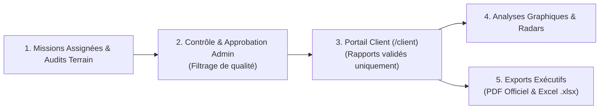

# Documentation Frontend - Espace Client Partenaire (`/client`)

Ce document détaille l'ensemble des modules, vues analytiques et fonctionnalités offerts aux **clients partenaires et directions de la qualité** sur la plateforme **Emberton Group**.

**Public cible :** Directeurs de réseaux, Responsables Qualité / Expérience Client, Enseignes partenaires.  
**Accès requis :** Authentification avec jeton JWT valide et rôle `client` (ou `admin` pour supervision).  
**URL de l'espace :** `https://app.embertongroup.com/client`

---

## 🧭 Vue d'ensemble & Cycle de Restitution

L'espace Client Partenaire est conçu comme un **portail décisionnel et analytique** permettant de suivre la conformité de l'expérience client dans l'ensemble des points de vente du réseau.

---

## 🔒 Sécurité & Cloisonnement des Données

1. **Cloisonnement Strict BOLA (Broken Object Level Authorization)** :
   - Un client partenaire ne peut **strictement accéder qu'aux missions rattachées à son propre identifiant (`clientId`)**.
   - Toute tentative d'accès à l'URL d'une mission tierce est immédiatement bloquée côté backend (`403 Forbidden`).
2. **Filtrage des Rapports Non Validés** :
   - Seuls les rapports d'audits ayant le statut **`approved`** ou **`paid`** (approuvés par l'administrateur coordinateur) sont visibles par le client.
   - Les brouillons, candidatures en cours ou audits refusés pour non-conformité demeurent masqués, garantissant la fiabilité des indicateurs présentés.

---

## 🎨 Charte Graphique & Design System

À l'instar des autres espaces, le portail client adopte l'identité exécutive **Emberton Group** :
* **Arrière-plan lumineux et aéré** : `bg-slate-100/70` ou `bg-slate-50/90`.
* **Cartes et conteneurs blancs purs** : `bg-white border-slate-200/80 shadow-sm rounded-2xl`.
* **Typographie & Titres** : Bleu Nuit `#041F40` avec accents Or `#D6C799`.
* **Indicateurs de statut** : Badges colorés discrets (Bleu pour disponible, Ambre pour en cours, Émeraude pour terminée).

---

## 📑 Pages et Modules de l'Espace Client

### 1. Portail Entreprise & Dashboard Central (`/client`)

Point d'entrée principal après connexion d'un utilisateur avec le rôle `client` :

* **En-tête de bienvenue personnalisé** : Affichage du nom de l'entreprise ou du responsable et compteur total de missions.
* **Indicateurs KPIs Synthétiques** :
  * **Missions en cours** : Enquêtes en phase de recrutement ou d'audit terrain.
  * **Missions terminées** : Campagnes d'audits finalisées et validées.
  * **Taux de complétion global** : Pourcentage d'audits réalisés par rapport au plan d'échantillonnage initial.
  * **Points de vente couverts** : Nombre total de boutiques ou agences auditées.
  * **Total des rapports reçus** : Volume global d'évaluations traitées.
* **Tableau de Supervision des Missions** :
  * Colonnes : Titre de la mission, Enseigne / Réseau, Nombre de boutiques, Date limite, Statut (`Disponible`, `En cours`, `Terminée`), Volume de rapports et Action d'accès.
  * **Recherche instantanée** : Filtrage par mot-clé (titre de mission, nom de boutique ou catégorie).
  * **Filtres de statut** : Bascule rapide entre *Toutes*, *En cours* et *Terminées*.
  * **Pagination unifiée `<DataPagination>`** : Navigation fluide avec sélection du nombre d'éléments par page (10, 20, 50).
  * Bouton d'action **« Voir les Rapports »** ouvrant le tableau de bord analytique détaillé.

---

### 2. Dashboard Analytique Détaillé par Mission (`/client/missions/:missionId`)

Cette vue immersive offre une restitution complète des résultats d'audit pour une campagne donnée :

#### A. Métriques Globales de Performance
* **Note Moyenne Globale** (sur 5 étoiles) calculée à partir des réponses des mystery shoppers.
* **Taux de Conformité** (%) mesurant l'adhésion aux standards de la marque.
* **Volume d'Audits Réalisés** et nombre de points de vente visités.

#### B. Filtres Dynamiques Multicritères
* **Sélecteur de Ville** : Permet d'isoler les résultats d'une agglomération spécifique (ex: Casablanca, Rabat, Paris).
* **Sélecteur de Point de Vente (Magasin)** : Focus immédiat sur une boutique physique spécifique.
* **Recherche par question** : Filtrage textuel pour isoler une thématique précise (ex: « caisse », « propreté », « sourire »).

#### C. Visualisations Graphiques Avancées
1. **Histogrammes de Distribution (Recharts BarChart)** : Répartition visuelle des notes par question ou par catégorie d'audit.
2. **Diagramme Radar Multidimensionnel (`RadarChart`)** :
   * **Radar de Conformité Global (`MissionAverageRadarChart`)** : Visualisation polygonale des axes d'évaluation (Accueil, Conseil, Rapidité, Merchandising, Encaissement).
   * **Comparaison Multi-Magasins (`MultiStoreRadarChart`)** : Superposition des profils de performance de plusieurs points de vente sur le même diagramme radar.

#### D. Onglets Thématiques d'Exploration
* **Vue d'ensemble** : Synthèse des scores et graphiques d'évolution.
* **Rapports Détaillés** : Consultation individuelle de chaque visite mystère (date de visite, auditeur anonymisé, réponses détaillées aux questions, commentaires qualitatifs).
* **Classement & Comparatif Magasins** : Tableau des boutiques classées par score de conformité décroissant pour identifier les meilleures pratiques et les axes de progrès.
* **Galerie de Justificatifs & Photos** : Affichage des photos prises in situ par les auditeurs (devanture, vitrine, propreté, ticket de caisse) avec agrandissement au clic.

#### E. Outils d'Exportation Exécutifs
Le client dispose de deux formats d'exportation professionnels téléchargeables en 1 clic :
1. **Export PDF Exécutif Multi-Pages (`jsPDF` + `autoTable`)** :
   * Génération côté client d'un document PDF prêt pour les comités de direction.
   * Présentation corporate Emberton Group : en-têtes officiels, logo, résumé exécutif, tableaux de scores par boutique et pagination automatique `Page X sur Y`.
2. **Export Excel Structuré (`.xlsx`) (`xlsx`)** :
   * Fichier tableur complet comprenant les données brutes de chaque enquête, notes par section et réponses aux questions pour traitement dans les outils BI internes du client (PowerBI, Tableau, Excel).

---

## 🛠️ Composants Clés & Dépendances Frontend

| Fichier / Composant | Rôle & Utilité |
| :--- | :--- |
| `src/app/client/page.jsx` | Page d'accueil du portail client et liste des missions |
| `src/app/client/missions/[missionId]/page.jsx` | Dashboard analytique complet, graphiques, filtres et exports |
| `src/components/radar-chart.jsx` | Composants de diagramme radar (moyenne et comparatif multi-magasins) |
| `src/components/ui/data-pagination.jsx` | Barre de pagination réutilisable |
| `src/services/fetchData.js` | Client API avec gestion de cache TanStack Query |
| `jsPDF` & `jspdf-autotable` | Moteur de génération des rapports PDF exécutifs |
| `xlsx` | Génération dynamique des classeurs Excel |

---

## 📡 Endpoints Backend Dédiés aux Clients

* `GET /api/clients/missions` : Liste des missions appartenant au client connecté (protégé par jeton JWT).
* `GET /api/clients/mission/:id` : Détails d'une mission avec vérification stricte de propriété (`clientId === user.id`).
* `GET /api/clients/reports/:id` : Rapports validés (`status in ['approved', 'paid']`) rattachés à la mission.
