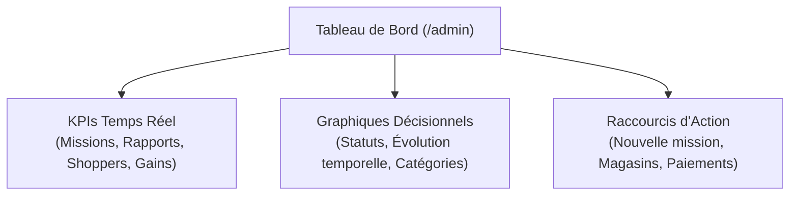
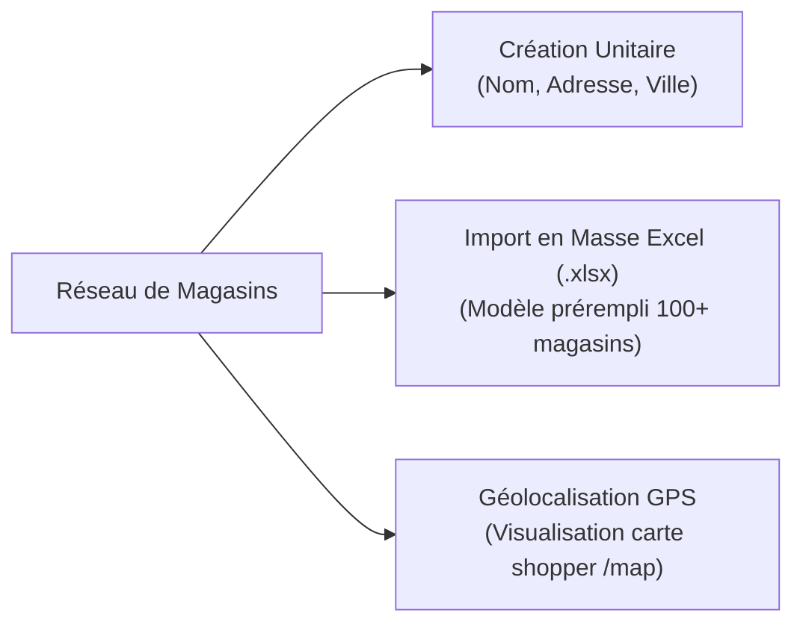

# 📘 Guide d'Utilisation Administrateur - Plateforme Emberton Group

> Manuel officiel d'exploitation et de gestion opérationnelle de la plateforme d'audits qualité et visites mystères **Emberton Group**.

---

## 📑 Sommaire

1. [Introduction & Accès à la Plateforme](#1-introduction--accès-à-la-plateforme)
2. [Tableau de Bord & KPIs (`/admin`)](#2-tableau-de-bord--kpis-admin)
3. [Gestion des Missions (`/admin/missions`)](#3-gestion-des-missions-adminmissions)
   * [Création d'une mission](#création-dune-nouvelle-mission)
   * [Assignation d'exception (directe)](#assignation-dexception-directe)
   * [Prolongation de date limite](#prolongation-de-date-limite)
4. [Éditeur d'Enquêtes Mystères (`/admin/missions/:id/survey/create`)](#4-éditeur-denquêtes-mystères)
5. [Revue des Rapports & Export PDF (`/admin/missions/:id/reports`)](#5-revue-des-rapports--export-pdf)
6. [Gestion du Réseau de Magasins (`/admin/stores`)](#6-gestion-du-réseau-de-magasins-adminstores)
   * [Création manuelle](#création-manuelle-dun-magasin)
   * [Import en masse via Excel / CSV](#import-en-masse-via-fichier-excel--csv)
7. [Traitement des Candidatures & Créneaux (`/admin/applications`)](#7-traitement-des-candidatures--créneaux-adminapplications)
8. [Gestion des Utilisateurs & Shoppers (`/admin/users`)](#8-gestion-des-utilisateurs--shoppers-adminusers)
9. [Suivi des Paiements & RIB (`/admin/payments`)](#9-suivi-des-paiements--rib-adminpayments)
10. [Messagerie & Support Terrain (`/admin/chat`)](#10-messagerie--support-terrain-adminchat)
11. [Sécurité & Bonnes Pratiques (`/admin/security`)](#11-sécurité--bonnes-pratiques)

---

## 1. Introduction & Accès à la Plateforme

### 🔐 Connexion à l'Espace Administrateur
1. Rendez-vous sur l'adresse officielle : [https://app.embertongroup.com/login](https://app.embertongroup.com/login).
2. Saisissez votre adresse email administrateur et votre mot de passe sécurisé.
3. Cliquez sur **« Se connecter »**.
4. Vous êtes automatiquement redirigé vers le tableau de bord administrateur (`/admin`).

> [!TIP]
> **Installation PWA :** Sur ordinateur (Google Chrome / Edge) ou tablette, vous pouvez installer l'application en cliquant sur l'icône d'installation dans la barre d'adresse pour un accès direct depuis votre bureau.

---

## 2. Tableau de Bord & KPIs (`/admin`)

Le tableau de bord centralise en temps réel la santé et l'activité de vos campagnes d'audits :

### Indicateurs Clés (En-tête) :
* **Missions Actives** : Nombre d'enquêtes actuellement ouvertes aux candidatures ou en cours de réalisation.
* **Rapports à Réviser** : Alertes sur les questionnaires soumis par les auditeurs nécessitant votre validation.
* **Candidatures en Attente** : Nombre de postulations d'auditeurs à traiter.
* **Shoppers Actifs** : Volume d'auditeurs qualifiés inscrits sur le réseau.
* **Règlements en Attente** : Montant total des rémunérations dues suite à des rapports validés.

### Graphiques Analytiques (Recharts) :
* **Répartition des Missions** : Camembert dynamique (Disponibles, Assignées, Clôturées).
* **Évolution des Inscriptions** : Courbe temporelle du recrutement de mystery shoppers.
* **Taux de Complétion par Enseigne** : Histogramme comparatif de réalisation par client partenaire.

---

## 3. Gestion des Missions (`/admin/missions`)

Cette section vous permet de piloter l'ensemble du cycle de vie des campagnes d'évaluation.

### Création d'une Nouvelle Mission
1. Cliquez sur le bouton **« + Nouvelle Mission »** en haut à droite.
2. Remplissez le formulaire guidé :
   * **Informations Générales** : Titre explicite (ex: *Audit Expérience Client Printemps - Casablanca*), Enseigne/Client rattaché, Catégorie (Luxe, Restauration, Retail, etc.).
   * **Conditions de Visite** : Rémunération par visite (en MAD ou EUR), date limite d'échéance.
   * **Documents PDF d'Accompagnement** :
     * *Briefing* : Consignes générales et posture de l'auditeur.
     * *Scénario* : Déroulé pas-à-pas de la visite en boutique.
     * *Questionnaire récapitulatif*.
   * **Magasins Cibles** : Sélectionnez les points de vente à rattacher à la mission.
3. Cliquez sur **« Enregistrer la mission »**.

### Assignation d'Exception (Directe)
Lorsque vous souhaitez attribuer une mission immédiatement à un auditeur de confiance **sans lui imposer de passer le quiz de qualification** ni attendre une postulation :
1. Dans le tableau des missions, cliquez sur le menu d'actions (icône `...`) $\rightarrow$ **« Assignation directe »**.
2. Sélectionnez le shopper dans la liste déroulante.
3. Choisissez le magasin attribué et le créneau horaire souhaité.
4. Cliquez sur **« Confirmer l'assignation »**. L'auditeur recevra automatiquement la mission dans son espace *Assignées* avec notification immédiate.

### Prolongation de Date Limite
Si une mission arrive à échéance et nécessite un délai supplémentaire pour finaliser les visites :
1. Cliquez sur le menu d'actions de la mission $\rightarrow$ **« Prolonger l'échéance »**.
2. Sélectionnez la nouvelle date de clôture dans le calendrier interactif.
3. Validez : la mission redevient immédiatement disponible pour les auditeurs.

---

## 4. Éditeur d'Enquêtes Mystères

Accessible via le bouton **« Modifier l'enquête »** sur chaque mission (`/admin/missions/:id/survey/create`) :

### Structure par Sections
Organisez le questionnaire en sections logiques pour faciliter le travail de terrain du shopper :
* *Section 1 : Accueil & Prise en charge*
* *Section 2 : Conseil & Découverte des besoins*
* *Section 3 : Merchandising & Propreté des lieux*
* *Section 4 : Passage en caisse & Prise de congé*

### Types de Questions Pris en Charge :
| Type | Description & Usage |
| :--- | :--- |
| **Notation par étoiles (Rating)** | Évaluation sur une échelle de 1 à 5 étoiles (avec libellés min/max). |
| **Choix unique (Radio)** | Une seule réponse possible parmi une liste de propositions. |
| **Choix multiple (Cases à cocher)** | Sélection libre de plusieurs options constatées. |
| **Texte libre / Commentaire** | Justification qualitative obligatoire ou facultative. |
| **Preuve Photo (Upload)** | Téléversement d'un justificatif (ticket de caisse, vitrine, rayon). |
| **Enregistrement Audio (Micro)** | Enregistrement vocal in situ de la visite. |
| **Date & Heure** | Horodatage exact de l'entrée et de la sortie de la boutique. |
| **Oui / Non** | Vérification de conformité binaire avec badge couleur. |

> [!NOTE]
> **Missions Clôturées :** Si la mission est marquée comme `completed` (terminée), l'éditeur passe en mode lecture seule sécurisé pour préserver l'intégrité des rapports déjà soumis, avec un lien direct vers la consultation des résultats.

---

## 5. Revue des Rapports & Export PDF (`/admin/missions/:id/reports`)

C'est ici que vous effectuez le **contrôle qualité** des visites soumises avant transmission au client final :

### Procédure de Revue d'un Rapport :
1. Ouvrez la mission et accédez à l'onglet **Rapports**.
2. Cliquez sur un rapport en attente (`submitted`).
3. Vérifiez les éléments de preuve :
   * Réponses aux questions et notes attribuées.
   * Commentaires rédigés par l'auditeur.
   * Photos justificatives (agrandissement en haute résolution).
   * Horodatage et cohérence de la visite.
4. **Décision Administrative** :
   * **Approuver le rapport (`approved`)** : Valide la visite, débloque l'indemnisation de l'auditeur et rend le rapport immédiatement visible dans l'espace du client partenaire.
   * **Refuser le rapport (`refused`)** : Saisissez obligatoirement un **motif explicite** (ex: *Ticket de caisse illisible, créneau non respecté*). Le shopper est notifié et la mission peut être réassignée.

### Génération du Rapport Exécutif PDF Multi-Pages
1. Cliquez sur le bouton **« Exporter en PDF »** en haut de la page des rapports.
2. Le moteur génère automatiquement un document PDF haute définition multi-pages comprenant :
   * En-tête corporate officiel Emberton Group avec logo.
   * Synthèse des scores moyens par axe d'évaluation.
   * Tableau récapitulatif de conformité de chaque boutique auditée.
   * Pagination dynamique `Page X sur Y`.
3. Le fichier est téléchargé instantanément sur votre ordinateur, prêt à être envoyé par email au client.

---

## 6. Gestion du Réseau de Magasins (`/admin/stores`)

Le module magasins vous permet de cartographier et de gérer l'intégralité du parc de points de vente des enseignes partenaires.

### Création Manuelle d'un Magasin :
1. Cliquez sur **« + Ajouter un Magasin »**.
2. Renseignez : Nom de la boutique, Ville, Adresse complète, Mission rattachée et Catégorie.
3. *(Optionnel)* Latitude et Longitude pour l'affichage sur la carte interactive.
4. Cliquez sur **« Créer le magasin »**.

### Import en Masse via Fichier Excel (.xlsx / .csv) :
Pour intégrer rapidement 50, 100 ou 500 boutiques :
1. Cliquez sur le bouton **« Importer Excel / CSV »**.
2. Dans la modale, cliquez sur **« Télécharger le modèle officiel (.xlsx) »**.
3. Remplissez le fichier Excel selon la structure :
   * `nom` (ex: *Boutique Maarif*)
   * `ville` (ex: *Casablanca*)
   * `adresse` (ex: *Boulevard Al Massira*)
   * `categorie` (ex: *Luxe*)
   * `mission_id` (Identifiant numérique de la mission)
   * `latitude` / `longitude` *(100% optionnelles)*
4. Glissez-déposez le fichier rempli dans la zone d'import.
5. Cliquez sur **« Lancer l'import »** : le système traite les lignes, gère automatiquement les accents et crée l'ensemble des points de vente en quelques secondes avec rapport de confirmation.

---

## 7. Traitement des Candidatures & Créneaux (`/admin/applications`)

Lorsqu'un shopper postule à une mission disponible :
1. Rendez-vous sur `/admin/applications`.
2. Examinez la fiche de l'auditeur : note moyenne, historique des missions, ville de résidence.
3. **Validation de la candidature** :
   * Sélectionnez la boutique attribuée dans le menu déroulant.
   * Définissez la plage horaire d'intervention (ex: *14h00 - 16h00*).
   * Cliquez sur **« Approuver »**.
4. L'auditeur reçoit immédiatement une notification de confirmation par email et dans son application PWA.

---

## 8. Gestion des Utilisateurs & Shoppers (`/admin/users`)

Supervision complète de l'annuaire des membres de la plateforme :
* **Filtrage par Rôle** : Mystery Shoppers (`shopper`), Clients Partenaires (`client`), Administrateurs (`admin`).
* **Activation / Désactivation en 1 Clic** : Si un auditeur ne respecte pas les consignes déontologiques, basculez son statut sur `Inactif` via le bouton dédié ; ses accès seront immédiatement révoqués.
* **Fiche Shopper Complète** : Consultation de la motivation, de l'âge, du CV téléchargé, de la note moyenne attribuée et de la liste de toutes ses missions passées.

---

## 9. Suivi des Paiements & RIB (`/admin/payments`)

Garantissez une indemnisation fluide et transparente de votre communauté de mystery shoppers :
1. Accédez à `/admin/payments` : visualisez la liste des rapports approuvés nécessitant un règlement.
2. Chaque ligne affiche :
   * Nom de l'auditeur et intitulé de la mission validée.
   * Montant exact de l'indemnisation convenue.
   * **Coordonnées Bancaires complètes** : Titulaire du compte, Nom de la banque, RIB / IBAN (24 chiffres pour le Maroc), code SWIFT/BIC et devise.
3. Une fois le virement bancaire émis par votre service comptable, cliquez sur **« Marquer comme Réglé »**.
4. La transaction est horodatée et archivée ; le shopper voit son statut basculer sur *Indemnité Payée*.

---

## 10. Messagerie & Support Terrain (`/admin/chat`)

Assurez une assistance réactive aux auditeurs en cours de mission :
* **Boîte de Réception Centrale** : Visualisez les conversations en cours avec compteur de messages non lus.
* **Discussion Instantanée** : Échangez en direct avec un shopper sur le terrain (doute sur une consigne de briefing, boutique fermée exceptionnellement, demande de report).
* **Interface Haute Visibilité** : Vos messages s'affichent en Bleu Nuit `#041F40` et les réponses des shoppers en blanc/ardoise à fort contraste.

---

## 11. Sécurité & Bonnes Pratiques

Pour garantir une sécurité maximale de la plateforme :
1. **Protection des Accès** : Utilisez un mot de passe robuste (au moins 10 caractères mêlant majuscules, minuscules, chiffres et caractères spéciaux). L'indicateur de sécurité de la page `/admin/security` vous guide dans le choix d'un mot de passe fort.
2. **Gestion des Déconnexions** : Pensez à vous déconnecter systématiquement lorsque vous quittez un poste partagé via le menu Profil en haut à droite $\rightarrow$ **« Se déconnecter »**.
3. **Protection Anti-Brute-Force Active** : Le système verrouille temporairement toute adresse IP tentant plus de 10 mots de passe erronés consécutifs pendant 15 minutes.
4. **Données Personnelles & Confidentialité** : Les coordonnées bancaires (RIB) et données personnelles des auditeurs sont strictement confidentielles et ne doivent en aucun cas être partagées à des tiers non habilités.

---

## 📞 Support Technique & Assistance

Pour toute question technique ou demande d'évolution sur la plateforme :
* **Support Développeur & Administration** : `contact@embertongroup.com`
* **Portail Web** : [https://app.embertongroup.com](https://app.embertongroup.com)
* **Bureau Paris** : +33 (0)1 42 68 55 00  
* **Bureau Casablanca** : Boulevard Al Massira Al Khadra, Casablanca

---
© 2024-2026 **Emberton Group**. Document confidentiel à usage interne exclusif.
